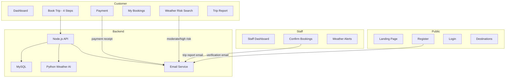

# Smart Travel Planner — System Wireframes (Interim)

University interim submission — Objectives 2 & 3: Smart Travel Planning and Booking with Weather-Based Risk Alerts.

---

## 1. System Overview



---

## 2. Customer Registration & Email Verification

```
┌─────────────────────────────────────────────────────────────┐
│  REGISTER (split layout)                                    │
│  ┌──────────────┐  ┌──────────────────────────────────────┐ │
│  │ Sri Lanka    │  │ Full Name, Username, Email, Phone    │ │
│  │ hero image   │  │ Password, Confirm Password           │ │
│  │              │  │ [ Register ]                         │ │
│  └──────────────┘  └──────────────────────────────────────┘ │
└─────────────────────────────────────────────────────────────┘
                          │
                          ▼
┌─────────────────────────────────────────────────────────────┐
│  CHECK YOUR EMAIL                                           │
│  Verification link sent to user@email.lk                      │
│  [ Resend ]  [ Go to Login ]                                │
└─────────────────────────────────────────────────────────────┘
                          │
                          ▼ (user clicks link in email)
┌─────────────────────────────────────────────────────────────┐
│  EMAIL VERIFIED ✓                                           │
│  Account activated → Login                                  │
└─────────────────────────────────────────────────────────────┘
```

**Flow:** Register → Email to registered address → Verify → Login allowed.

---

## 3. Booking Flow (4 Steps)

```
Step 1: SELECT TRIP
┌─────────────────────────────────────┐
│ Destination ▼  Activity ▼           │
│ Travelers [2]  Travel Date [date]    │
│ Total: Rs. 95,000                   │
│ [ Check Weather Risk → ]            │
└─────────────────────────────────────┘
                  │
                  ▼
Step 2: WEATHER RISK (OpenWeatherMap → Python)
┌─────────────────────────────────────┐
│ Kandy — Live weather stats          │
│ Risk: MODERATE                      │
│ Recommendation text...              │
│ → Email alert if moderate/high      │
│ [ Confirm & Proceed to Payment ]    │
└─────────────────────────────────────┘
                  │
                  ▼
Step 3: BOOKING CREATED (pending)
                  │
                  ▼
Step 4: PAYMENT
┌─────────────────────────────────────┐
│ Card Name / Number / Expiry / CVV   │
│ [ Pay Rs. 95,000 ]                  │
│ → Payment confirmation email        │
└─────────────────────────────────────┘
                  │
                  ▼
         My Bookings (pending staff confirm)
```

---

## 4. Staff Workflow

```
┌─────────────────────────────────────────────────────────────┐
│  STAFF BOOKINGS                                             │
│  Filter: Pending | Confirmed | Completed                    │
│  ┌─────────────────────────────────────────────────────────┐│
│  │ Sigiriya — Nimal — Rs.95,000 — Risk: moderate — PAID  ││
│  │ [ Confirm ] [ Reject ] [ Complete ]                     ││
│  └─────────────────────────────────────────────────────────┘│
└─────────────────────────────────────────────────────────────┘
                          │
              Confirm booking
                          ▼
         Trip Report email → customer inbox
         Trip Report page → /trip-report/:id
```

---

## 5. Weather Risk Alert Email

Triggered when logged-in customer runs weather analysis and risk is **moderate** or **high**.

| Field | Content |
|-------|---------|
| To | Customer registered email |
| Subject | Weather Risk Alert — {Place} ({LEVEL}) |
| Body | Destination, date, risk, recommendation, weather stats |

Also available on **Weather Risk** page (search any Sri Lanka place).

---

## 6. Trip Report

| Section | Data |
|---------|------|
| Booking | Destination, activity, date, travelers, price |
| Payment | Status, transaction ID |
| Weather | Risk level, temp, rain, wind, recommendation |
| Delivery | In-app `/trip-report/:id` + email when staff confirms |

---

## 7. Page Map (All Roles)

| Page | Route | Role |
|------|-------|------|
| Landing | `/` | Public |
| Register | `/register` | Public |
| Register Success | `/register-success` | Public |
| Verify Email | `/verify-email?token=` | Public |
| Login | `/login` | Public |
| Dashboard | `/dashboard` | Customer |
| Book Trip | `/booking` | Customer |
| Payment | `/payment/:id` | Customer |
| My Bookings | `/bookings` | Customer |
| Weather Risk | `/weather-risk` | Customer |
| Trip Report | `/trip-report/:id` | Customer / Staff |
| Staff Dashboard | `/staff` | Staff |
| Admin Panel | `/admin` | Admin |

---

## 8. Email Configuration

Add to `backend/.env` for real emails (Gmail App Password example):

```
SMTP_HOST=smtp.gmail.com
SMTP_PORT=587
SMTP_USER=your@gmail.com
SMTP_PASS=app_password
SMTP_FROM=Smart Travel Planner <noreply@smarttravel.lk>
```

**Without SMTP:** emails print in the backend terminal (dev mode) — copy the verification link from there.

---

## 9. Demo Accounts (after `npm run seed`)

| Role | Username | Password |
|------|----------|----------|
| Customer | nimal | user123 |
| Staff | staff01 | staff123 |
| Admin | admin | admin123 |

Demo customer is pre-verified. New registrations must verify email first.

---

## 10. Full End-to-End Test

1. Register new user with real email (or check backend console for link)
2. Click verify link → Login
3. Book trip → Weather check → Confirm → Pay
4. Login as staff → Confirm booking → Customer gets trip report email
5. Weather Risk page → moderate/high → risk alert email
